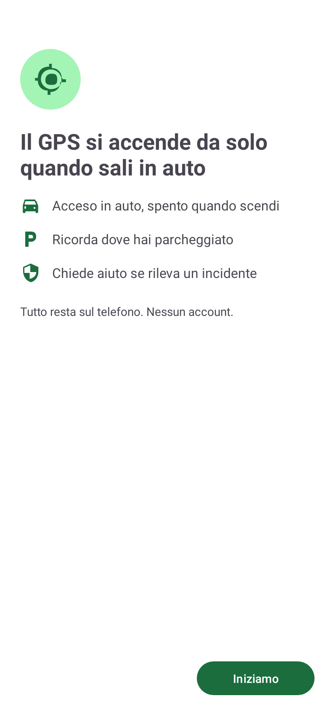
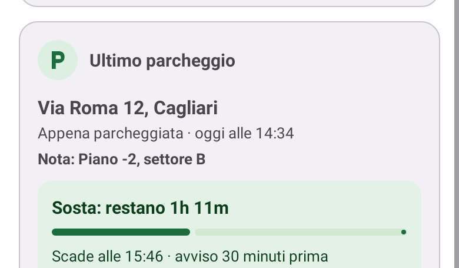
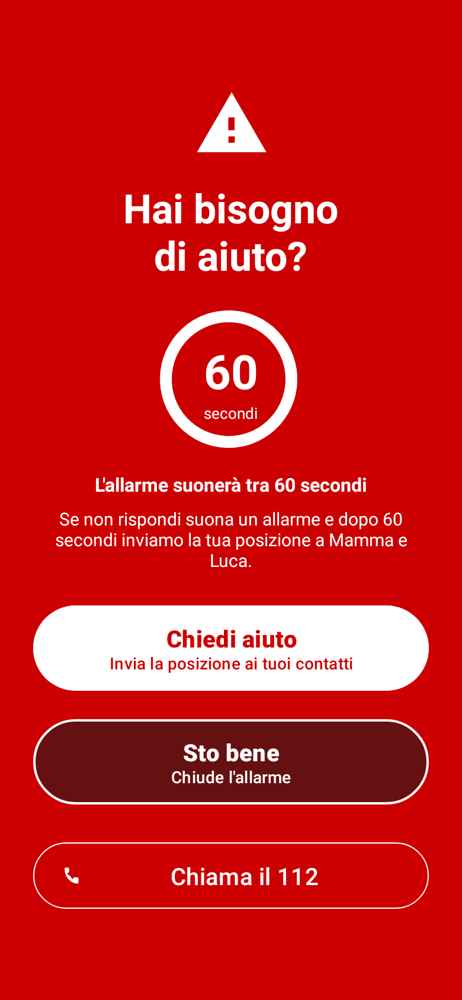

<p align="center">
  
</p>

# AutoGPS by Bonn

[English](README.md) | **Italiano**

App Android che accende il GPS quando sali in auto e lo spegne quando scendi, ricorda dove hai parcheggiato, chiede aiuto dopo un incidente e ti avvisa prima delle ZTL italiane.

[](https://github.com/AndreaBonn/AutoGPS-by-Bonn/releases/latest)


Ogni volta che sali in auto devi ricordarti di accendere il GPS, e ogni volta che scendi devi ricordarti di spegnerlo per risparmiare batteria. AutoGPS lo fa al posto tuo.

L'app reagisce quando il telefono si collega al Bluetooth dell'auto o quando parte Android Auto. Mentre guidi controlla se c'è un incidente e se ti stai avvicinando a una ZTL; quando scendi salva il parcheggio. Non servono account né server: tutto resta sul telefono.

**Download: [ultima release](https://github.com/AndreaBonn/AutoGPS-by-Bonn/releases/latest)** (APK, da installare con la guida qui sotto)

## In pratica

<p align="center">
  
</p>

La guida al primo avvio ti accompagna nei permessi, nella scelta del Bluetooth dell'auto e nel permesso di sistema da dare una volta sola.

## Indice

- [Funzionalità](#funzionalità)
- [Requisiti](#requisiti)
- [Guida all'installazione](#guida-allinstallazione)
- [Aggiornamenti](#aggiornamenti)
- [Risoluzione problemi](#risoluzione-problemi)
- [Limitazioni note](#limitazioni-note)
- [Privacy e sicurezza](#privacy-e-sicurezza)
- [Changelog](#changelog)
- [Feedback e supporto](#feedback-e-supporto)
- [Supporta il progetto](#supporta-il-progetto)
- [Autore e licenza](#autore-e-licenza)

---

## Funzionalità

L'app ha tre schede: **Home** mostra lo stato del GPS, cosa manca alla configurazione e l'ultimo parcheggio; **Funzioni** contiene gli interruttori di ogni funzione; **Impostazioni** contiene il comportamento allo spegnimento del GPS, il permesso di sistema, la lingua (italiano o inglese) e la scheda Informazioni.

### GPS acceso in auto, spento quando scendi

AutoGPS reagisce a due trigger:

- **Bluetooth dell'auto**: scegli uno o più dispositivi (vivavoce, autoradio, adattatore OBD). Quando almeno uno si collega, il GPS si accende. Quando si scollegano tutti, si spegne.
- **Android Auto**: quando parte Android Auto, il GPS si accende. L'app usa l'API ufficiale di connessione all'auto, quindi basta attivare "Usa Android Auto".

I due trigger lavorano insieme: il GPS resta acceso finché uno dei due è attivo. Quando finiscono entrambi, il GPS si spegne dopo 20-35 secondi, il tempo che serve a salvare un parcheggio preciso, così un breve calo del Bluetooth non lo spegne. AutoGPS spegne solo il GPS che ha acceso lui: se l'avevi già acceso a mano, lo lascia com'è.

L'interruttore **AutoGPS attivo** in cima a Funzioni mette tutto in pausa: finché è spento, l'app non tocca il GPS.

In Impostazioni scegli cosa significa "spento":

- **Disattiva GPS completamente** (predefinito): massimo risparmio di batteria, le altre app non sanno dove sei
- **Modalità risparmio batteria**: app come meteo e mappe ricevono una posizione approssimativa da rete e Wi-Fi, senza il chip GPS

### Ultimo parcheggio

<p align="center">
  
</p>

Quando lasci l'auto l'app salva il punto e lo mostra sulla mappa con l'indirizzo e da quanto tempo hai parcheggiato. "Vai alla macchina" avvia la navigazione a piedi. Il punto viene salvato solo da una posizione recente e precisa, e viene sostituito solo se ti sposti di più di 100 metri o dopo un viaggio di almeno 10 minuti.

- **Nota**: un testo libero come "Piano -2, settore B"
- **Timer sosta**: 15 min, 30 min, 1 ora, 2 ore o una durata personalizzata, con conto alla rovescia. I promemoria suonano 30 e 15 minuti prima della scadenza (quando la durata lo permette) e alla scadenza, anche in modalità silenziosa e Non disturbare
- **Widget**: un widget nella schermata Home mostra l'indirizzo e il tempo trascorso dal parcheggio; toccandolo parte la navigazione verso l'auto

Tutto resta sul telefono.

### Rilevamento incidenti

<p align="center">
  
</p>

Mentre guidi, l'app usa l'accelerometro per rilevare un urto forte. Il sensore si arma solo quando l'auto è in movimento (sopra circa 15 km/h), quindi un telefono che cade in un'auto parcheggiata non conta. Dopo un urto l'app aspetta che l'auto smetta di muoversi, poi verifica con il GPS per 3 minuti che resti ferma.

Se resta ferma, compare una schermata rossa di emergenza, anche a schermo bloccato:

- **Chiedi aiuto** invia un SMS ai contatti di emergenza con la tua posizione come link Google Maps e la velocità misurata prima dell'urto. Se il GPS non ha una posizione (galleria, parcheggio sotterraneo), l'SMS scrive "POSIZIONE NON DISPONIBILE" invece di mandarne una sbagliata
- **Sto bene** chiude l'allarme
- **Chiama il 112** apre il telefono con il numero unico di emergenza

Se nessuno risponde entro 60 secondi, suona un allarme a volume crescente dall'altoparlante del telefono (mai dal Bluetooth), mettendo in pausa la musica. Dopo altri 60 secondi l'SMS parte da solo, così i contatti vengono avvisati anche se non puoi rispondere. La schermata ti dice poi quanti telefoni dei contatti hanno confermato la consegna, non solo quanti messaggi sono partiti.

Impostazioni nella sezione Rilevamento incidenti:

- **Sensibilità**: Bassa, Media (predefinita, 2,0 G) o Alta
- **Contatti di emergenza**: fino a 10, importati dalla rubrica o inseriti a mano
- **Prova la schermata di emergenza**: una prova che mostra la schermata vera senza inviare SMS

### Avvisi ZTL

Un avviso a schermo intero ti avverte prima di entrare in una zona a traffico limitato attiva. Il dataset copre 302 zone in 135 città italiane, è incluso nell'app (funziona offline) e viene aggiornato da questo repository al massimo una volta al giorno.

- L'avviso scatta solo quando sei entro 200 metri e ti stai dirigendo verso la zona, non ogni volta che ci passi vicino. Mostra la distanza e si chiude da solo dopo 15 secondi
- Le zone con orario non verificato sono segnalate con "Orario non verificato: controlla il cartello"; puoi scegliere di essere avvisato solo per le ZTL con orario noto
- Puoi aggiungere le zone in cui sei autorizzato, e non ti avviseranno mai
- Quando sei lontano da tutte le zone, l'app controlla la posizione meno spesso per risparmiare batteria

I dati sono indicativi: segui sempre la segnaletica.

---

## Requisiti

- **Android 8.0 o superiore** (fino ad Android 16). Testato su Pixel 8 Pro.
- **Un computer** (Windows, Mac o Linux) con una porta USB e un cavo dati, necessario una volta sola per la configurazione iniziale.

---

## Guida all'installazione

Android non permette alle app normali di accendere e spegnere il GPS. AutoGPS ha bisogno di un permesso di sistema che concedi una volta sola da un computer, con uno strumento gratuito di Google chiamato ADB. La guida ha 9 passi; i passi 2-7 si fanno una volta sola e la prima volta richiedono circa 15-20 minuti.

### Passo 1: Scarica l'APK

L'APK è il file di installazione delle app Android. AutoGPS non è sul Play Store, quindi lo scarichi da qui.

**Vai alla [pagina delle release](https://github.com/AndreaBonn/AutoGPS-by-Bonn/releases/latest) e scarica l'ultimo `AutoGPS-by-Bonn-vX.Y.Z.apk`** dalla sezione "Assets" (circa 9 MB).

> **Ti preoccupa la sicurezza?** Il documento [Sicurezza](SECURITY.it.md) elenca le misure implementate nell'app: archiviazione cifrata, nessun server, nessun tracciamento, SMS verificati.

Il file viene salvato nella cartella **Download** del computer.

### Passo 2: Prepara il computer

Per concedere il permesso userai **ADB** (Android Debug Bridge), un programma che permette al computer di inviare istruzioni al telefono tramite il cavo USB.

Non devi installare niente di complicato: ADB è un piccolo programma da scaricare ed estrarre. **Android Studio non serve.**

Vai alla pagina ufficiale di Google **https://developer.android.com/tools/releases/platform-tools** e scarica la versione per il tuo sistema operativo.

**Windows:**

1. Clicca **"Download SDK Platform-Tools for Windows"**
2. Accetta i termini e clicca "Download"
3. Apri il file zip scaricato e trascina la cartella `platform-tools` nella cartella **Download**

**Mac:**

1. Clicca **"Download SDK Platform-Tools for Mac"**
2. Accetta i termini e clicca "Download"
3. Apri il file zip scaricato e trascina la cartella `platform-tools` nella cartella **Download**
4. In alternativa, con Homebrew: `brew install android-platform-tools`

**Linux (Ubuntu/Debian):**

1. Clicca **"Download SDK Platform-Tools for Linux"** ed estrailo, oppure apri il terminale e scrivi:

   ```
   sudo apt install adb
   ```

### Passo 3: Attiva le Opzioni sviluppatore sul telefono

1. **Apri l'app Impostazioni** del telefono
2. **Apri "Informazioni sul telefono"** (può chiamarsi "Info telefono" o "Informazioni dispositivo")
3. **Cerca "Numero build"**. Su alcuni telefoni è dentro "Informazioni software" o "Informazioni sulla versione"
4. **Tocca "Numero build" 7 volte di fila.** Dopo qualche tocco un messaggio conta i passi mancanti; al settimo tocco compare "Ora sei uno sviluppatore!". Se il telefono ha un PIN, potrebbe chiedertelo
5. **Torna indietro** alla schermata principale delle Impostazioni
6. **Cerca la nuova voce "Opzioni sviluppatore"**: nella lista principale, oppure in **Sistema** > **Avanzate** > **Opzioni sviluppatore**, secondo il produttore

### Passo 4: Attiva il debug USB

1. **Apri "Opzioni sviluppatore"**
2. **Cerca "Debug USB"** (su alcuni telefoni "Debug Android")
3. **Attiva l'interruttore**
4. Compare un avviso: **tocca "OK"**

### Passo 5: Collega il telefono al computer

1. **Collega il telefono con un cavo USB.** Se puoi usa il cavo originale: alcuni cavi economici caricano soltanto e non trasferiscono dati
2. Se il telefono chiede la modalità USB, **scegli "Trasferimento file"** (o "MTP"), non "Solo ricarica"
3. Il telefono chiede **"Consentire il debug USB?"** con una "impronta digitale della chiave RSA". **Tocca "Consenti"**; puoi anche spuntare "Consenti sempre da questo computer"

Se la richiesta non compare: scollega e ricollega il cavo, oppure disattiva e riattiva il debug USB, e controlla che sia selezionato "Trasferimento file".

### Passo 6: Apri il terminale sul computer

Il terminale è una finestra in cui si scrivono comandi di testo. Userai solo 3 comandi, copiati da questa guida.

**Windows:** premi **tasto Windows + R**, scrivi **`cmd`** e premi Invio. Si apre una finestra nera: è il Prompt dei comandi.

**Mac:** premi **Cmd + Spazio**, scrivi **"Terminale"** e premi Invio.

**Linux:** cerca **"Terminale"** nel menu delle applicazioni, oppure premi **Ctrl + Alt + T**.

### Passo 7: Installa l'APK e concedi il permesso

**Entra nella cartella `platform-tools`** (se l'hai messa in Download):

Windows:

```
cd %USERPROFILE%\Downloads\platform-tools
```

Mac/Linux:

```
cd ~/Downloads/platform-tools
```

**Controlla che il telefono sia riconosciuto:**

```
adb devices
```

Dovresti vedere:

```
List of devices attached
XXXXXXXX    device
```

Se vedi `unauthorized`, guarda il telefono e tocca "Consenti" sulla richiesta di debug USB. Se non compare nessun dispositivo, controlla il cavo e la modalità "Trasferimento file".

**Installa l'APK** (usa il nome esatto del file che hai scaricato):

Windows:

```
adb install "%USERPROFILE%\Downloads\AutoGPS-by-Bonn-v3.1.0.apk"
```

Mac/Linux:

```
adb install ~/Downloads/AutoGPS-by-Bonn-v3.1.0.apk
```

Alla fine compare `Success`.

Puoi anche copiare l'APK sul telefono (cavo, email, Google Drive...) e aprirlo dal file manager; Android ti chiederà di consentire l'installazione da origini sconosciute. Il comando del permesso qui sotto serve comunque.

**Concedi il permesso di sistema.** Senza, l'app non può controllare il GPS:

```
adb shell pm grant com.autogps.app android.permission.WRITE_SECURE_SETTINGS
```

Se il comando riesce **non compare nessun messaggio**: il cursore passa semplicemente alla riga successiva. Se compare un errore, vedi [Risoluzione problemi](#risoluzione-problemi).

L'app mostra questo comando anche nella guida al primo avvio, con un pulsante **Condividi** per mandartelo via email o chat.

### Passo 8: Configura l'app

Apri AutoGPS. La guida al primo avvio ha quattro pagine:

1. **Benvenuto**: cosa fa l'app
2. **Permessi**: concedi Dispositivi nelle vicinanze, Posizione, **Posizione sempre** (scegli "Consenti sempre", altrimenti l'app non funziona a schermo spento) e Notifiche
3. **La tua auto**: scegli il Bluetooth dell'auto tra i dispositivi già associati al telefono
4. **Permesso di sistema**: il comando del passo 7. La pagina si aggiorna da sola quando il permesso è concesso

Dopo la guida, la scheda **Per finire la configurazione** in Home elenca cosa manca ancora, ognuno con il suo pulsante:

- **Lascia AutoGPS attivo**: esclude l'app dall'ottimizzazione della batteria, così Android non la ferma
- **Allarme a schermo bloccato**: serve per la schermata di emergenza dopo un incidente

**Facoltativo:**

- **Android Auto**: in Funzioni attiva "Usa Android Auto". Se l'auto ha il Bluetooth non serve: il Bluetooth è più affidabile e consuma meno
- **Contatti di emergenza**: in Funzioni > Rilevamento incidenti tocca "Contatti di emergenza" e aggiungine almeno uno, dalla rubrica o a mano. L'app chiede il permesso di inviare SMS. Poi usa "Prova la schermata di emergenza" per vedere come funziona senza inviare niente
- **Avvisi ZTL**: in Funzioni attiva "Avvisami prima delle ZTL" e aggiungi le zone in cui sei autorizzato

### Passo 9: Verifica che funzioni

1. **Controlla che il GPS sia spento**
2. **Collega il Bluetooth dell'auto**
3. **Controlla che il GPS si accenda** entro pochi secondi
4. **Scollega il Bluetooth**
5. **Controlla che il GPS si spenga** dopo 20-35 secondi: il ritardo è voluto, per non spegnere durante un breve scollegamento e per salvare il parcheggio

---

## Aggiornamenti

Quando esce una nuova versione, l'app mostra un avviso di aggiornamento (controllato al massimo una volta al giorno). Scarica il nuovo APK e installalo con:

```
adb install -r AutoGPS-by-Bonn-vX.Y.Z.apk
```

`-r` reinstalla mantenendo i dati. Le impostazioni restano e **non devi concedere di nuovo il permesso di sistema**. Puoi anche installare l'APK direttamente dal telefono, con lo stesso risultato.

---

## Risoluzione problemi

**Il computer non vede il telefono (`adb devices` non mostra niente)**

- Controlla il cavo da entrambi i lati, o prova un'altra porta USB
- Controlla di aver scelto "Trasferimento file" sul telefono, non "Solo ricarica"
- Su Windows potrebbe servire il driver USB del telefono: cerca "driver USB [modello del tuo telefono]"

**`adb devices` mostra `unauthorized`**

- Guarda il telefono e tocca "Consenti" sulla richiesta "Consentire il debug USB?"
- Se non compare: scollega il cavo, disattiva e riattiva il debug USB, ricollega il cavo

**"adb non è riconosciuto" o "command not found"**

- Controlla di essere entrato nella cartella `platform-tools` con `cd`
- Su Windows, controlla di aver estratto lo zip e di essere dentro `platform-tools`, non nella cartella sopra

**Il GPS non si accende dopo la configurazione**

- Esegui di nuovo il comando del permesso: `adb shell pm grant com.autogps.app android.permission.WRITE_SECURE_SETTINGS`
- Guarda la scheda **Per finire la configurazione** in Home: elenca cosa manca ancora
- Controlla che l'interruttore **AutoGPS attivo** in Funzioni sia acceso
- Su telefoni Xiaomi, Samsung, Huawei o Oppo, leggi [Limitazioni note](#limitazioni-note)

**L'app smette di funzionare dopo qualche giorno**

- Alcuni produttori (Xiaomi, Huawei, Oppo) fermano le app in background in modo aggressivo. Segui le istruzioni per il tuo modello su [dontkillmyapp.com](https://dontkillmyapp.com)
- Controlla che "Lascia AutoGPS attivo" risulti fatto nella scheda di configurazione

---

## Limitazioni note

- Il controllo del GPS funziona su Pixel e su telefoni con Android stock. Sulle interfacce molto personalizzate (Xiaomi MIUI/HyperOS, Samsung One UI) il comportamento può variare con la versione del sistema.
- Alcuni produttori (Xiaomi, Huawei, Oppo) sospendono i servizi in background; vedi [dontkillmyapp.com](https://dontkillmyapp.com).
- Il rilevamento incidenti usa l'accelerometro del telefono. Su strade molto sconnesse può dare falsi allarmi: in quel caso abbassa la sensibilità.
- Gli SMS di emergenza richiedono una SIM attiva con credito. La conferma di consegna dipende dall'operatore, che deve inviare i rapporti di consegna.
- I dati ZTL vengono da OpenStreetMap e sono indicativi: vale sempre la segnaletica.

---

## Privacy e sicurezza

L'app non ha account, analytics né tracker. Parcheggi, contatti di emergenza e dispositivi dell'auto sono salvati cifrati sul telefono. Le uniche connessioni di rete scaricano file pubblici: il controllo aggiornamenti, l'elenco delle ZTL e le tile di OpenStreetMap per la mappa del parcheggio e il widget. Gli SMS di emergenza partono direttamente dal tuo telefono verso i contatti che hai scelto.

L'elenco completo delle misure, e come segnalare una vulnerabilità, è in [SECURITY.it.md](SECURITY.it.md).

---

## Changelog

La cronologia completa delle versioni è in [CHANGELOG.it.md](CHANGELOG.it.md).

---

## Feedback e supporto

Hai trovato un bug o hai una richiesta? Vedi [FEEDBACK.it.md](FEEDBACK.it.md) per sapere come contattarmi.

---

## Supporta il progetto

AutoGPS è gratuita. Se ti è utile, lascia una stella al [repository](https://github.com/AndreaBonn/AutoGPS-by-Bonn): aiuta altri a trovarlo. Se vuoi ricambiare, puoi lasciare una mancia via PayPal; l'importo lo decidi tu ed è facoltativo.

<p align="center">
  <a href="https://paypal.me/AndreaBonacci19"></a>
</p>

---

## Autore e licenza

Sviluppata da [Andrea Bonacci](https://github.com/AndreaBonn). Il codice sorgente è privato; l'app è gratuita alle condizioni indicate in [LICENSE](LICENSE).

**Fonti dei dati:** i confini delle ZTL provengono da OpenStreetMap, © OpenStreetMap contributors, distribuiti con licenza [Open Database License (ODbL)](https://opendatacommons.org/licenses/odbl/). Vedi [openstreetmap.org/copyright](https://www.openstreetmap.org/copyright).
