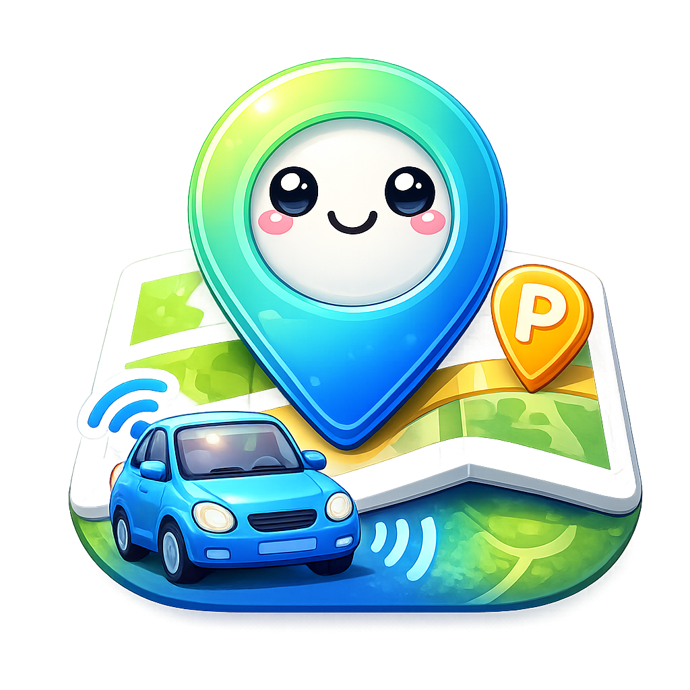
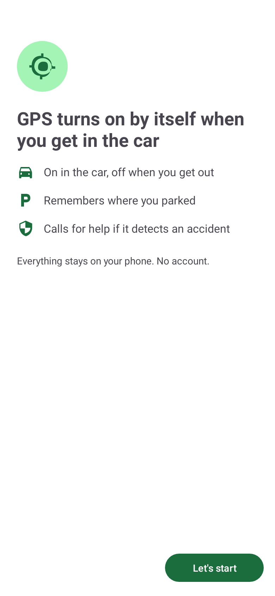
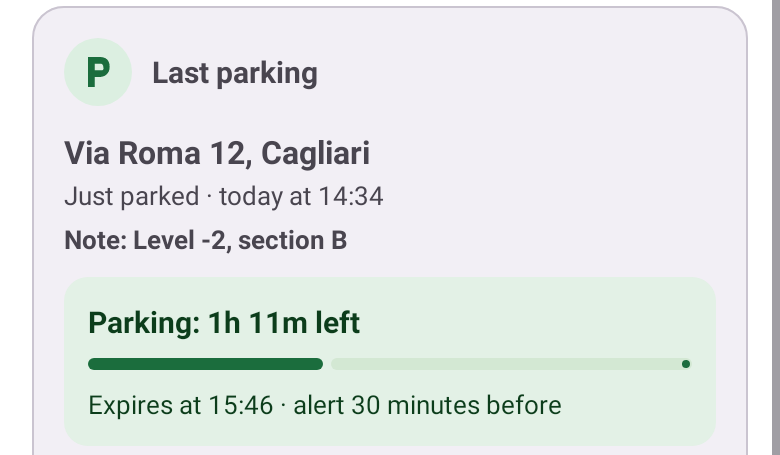
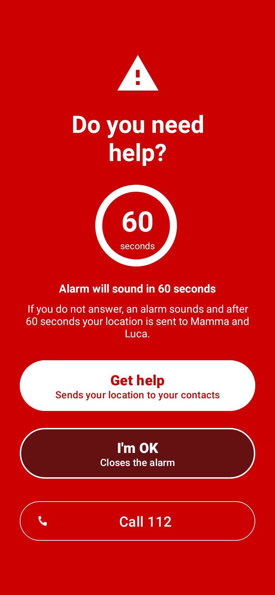

<p align="center">
  
</p>

# AutoGPS by Bonn

**English** | [Italiano](README.it.md)

An Android app that turns GPS on when you get in the car and off when you get out, remembers where you parked, calls for help after an accident and warns you before Italian limited traffic zones (ZTL).

[](https://github.com/AndreaBonn/AutoGPS-by-Bonn/releases/latest)


Every time you get in the car you have to remember to turn on GPS, and every time you get out you have to remember to turn it off to save battery. AutoGPS does it for you.

The app reacts when the phone connects to your car's Bluetooth or when Android Auto starts. While you drive it watches for accidents and approaching ZTL zones; when you get out it saves the parking spot. It needs no account and no server: everything stays on the phone.

**Download: [latest release](https://github.com/AndreaBonn/AutoGPS-by-Bonn/releases/latest)** (APK, installed with the guide below)

## In practice

<p align="center">
  
</p>

The first-run guide walks you through permissions, the choice of your car's Bluetooth and the one-time system permission.

## Contents

- [Features](#features)
- [Requirements](#requirements)
- [Installation guide](#installation-guide)
- [Updating](#updating)
- [Troubleshooting](#troubleshooting)
- [Known limitations](#known-limitations)
- [Privacy and security](#privacy-and-security)
- [Changelog](#changelog)
- [Feedback and support](#feedback-and-support)
- [Support the project](#support-the-project)
- [Author and license](#author-and-license)

---

## Features

The app has three tabs: **Home** shows the GPS status, what is left to set up and the last parking; **Features** holds the switches for each function; **Settings** holds the GPS-off behavior, the system permission, the language (Italian or English) and the About card.

### GPS on in the car, off when you get out

AutoGPS reacts to two triggers:

- **Car Bluetooth**: you choose one or more devices (hands-free, car stereo, OBD adapter). When at least one connects, GPS turns on. When all disconnect, it turns off.
- **Android Auto**: when Android Auto starts, GPS turns on. The app reads the official car connection API, so turning on "Use Android Auto" is all it takes.

The two triggers work together: GPS stays on as long as one of them is active. When both end, GPS turns off after 20 to 35 seconds, the time needed to save an accurate parking spot, so a brief Bluetooth drop does not switch it off. AutoGPS only turns off GPS that it turned on itself: if you had already switched it on by hand, it leaves it alone.

The **AutoGPS on** switch at the top of Features pauses everything: while it is off, the app does not touch GPS.

In Settings you choose what "off" means:

- **Turn GPS off completely** (default): maximum battery saving, other apps do not know where you are
- **Battery saving mode**: other apps such as weather and maps get an approximate location from network and Wi-Fi, without the GPS chip

### Last parking

<p align="center">
  
</p>

When you leave the car the app saves the spot and shows it on the map with the address and how long ago you parked. "Go to car" starts walking navigation. The spot is saved only from a fresh and accurate position, and is replaced only if you move more than 100 meters or after a trip of at least 10 minutes.

- **Note**: a free-text note such as "Level -2, section B"
- **Parking timer**: 15 min, 30 min, 1 hour, 2 hours or a custom duration, with a live countdown. Reminders sound 30 and 15 minutes before expiry (when the duration allows) and at expiry, even in silent and Do Not Disturb mode
- **Widget**: a home screen widget shows the address and the time since you parked; tapping it opens navigation to the car

Everything stays on the phone.

### Accident detection

<p align="center">
  
</p>

While you drive, the app uses the accelerometer to detect a strong impact. The sensor is armed only while the car is moving (above about 15 km/h), so a phone dropped in a parked car does not count. After an impact the app waits for the car to stop rolling, then checks with GPS for 3 minutes whether it stays still.

If it does, a red emergency screen appears, also on the lock screen:

- **Get help** sends an SMS to your emergency contacts with your position as a Google Maps link and the speed measured before the impact. If GPS has no position (tunnel, underground car park), the SMS says "LOCATION NOT AVAILABLE" instead of sending a wrong one
- **I'm OK** closes the alarm
- **Call 112** opens the dialer with the European emergency number

If nobody answers within 60 seconds, an alarm sounds at increasing volume through the phone speaker (never Bluetooth), pausing any music. After another 60 seconds the SMS is sent automatically, so your contacts are alerted even if you cannot respond. The screen then tells you how many contacts' phones confirmed delivery, not only how many messages left.

Settings in the Crash detection section:

- **Sensitivity**: Low, Medium (default, 2.0 G) or High
- **Emergency contacts**: up to 10, imported from the phonebook or entered by hand
- **Try the emergency screen**: a rehearsal that shows the real screen without sending any SMS

### ZTL alerts (Italy)

A full-screen alert warns you before you enter an active limited traffic zone. The dataset covers 302 zones in 135 Italian cities, is bundled with the app (works offline) and is refreshed from this repository at most once a day.

- The alert fires only when you are within 200 meters and heading towards the zone, not every time you drive nearby. It shows the distance and closes by itself after 15 seconds
- Zones whose hours are not verified are labelled "Hours not verified: check the sign"; you can choose to be alerted only for zones with known hours
- You can add the zones you are allowed to enter, and they will never alert you
- When you are far from every zone, the app checks the position less often to save battery

The data is indicative: always follow the road signs.

---

## Requirements

- **Android 8.0 or higher** (up to Android 16). Tested on Pixel 8 Pro.
- **A computer** (Windows, Mac or Linux) with a USB port and a data cable, needed only once for the initial setup.

---

## Installation guide

Android does not let ordinary apps turn GPS on and off. AutoGPS needs a system permission that you grant once from a computer with a free Google tool called ADB. The guide has 9 steps; steps 2-7 are done only once and take about 15-20 minutes the first time.

### Step 1: Download the APK

An APK is the installation file for Android apps. AutoGPS is not on the Play Store, so you download it from here.

**Go to the [releases page](https://github.com/AndreaBonn/AutoGPS-by-Bonn/releases/latest) and download the latest `AutoGPS-by-Bonn-vX.Y.Z.apk`** from the "Assets" section (about 9 MB).

> **Concerned about security?** The [Security](SECURITY.md) document lists the measures implemented in the app: encrypted storage, no servers, no tracking, verified SMS.

The file is saved in your computer's **Downloads** folder.

### Step 2: Prepare the computer

To grant the permission you will use **ADB** (Android Debug Bridge), a program that lets the computer send instructions to the phone over the USB cable.

You do not need to install anything complicated: ADB is a small program you download and extract. **Android Studio is not needed.**

Go to the official Google page **https://developer.android.com/tools/releases/platform-tools** and download the version for your operating system.

**Windows:**

1. Click **"Download SDK Platform-Tools for Windows"**
2. Accept the terms and click "Download"
3. Open the downloaded zip file and drag the `platform-tools` folder into your **Downloads** folder

**Mac:**

1. Click **"Download SDK Platform-Tools for Mac"**
2. Accept the terms and click "Download"
3. Open the downloaded zip file and drag the `platform-tools` folder into your **Downloads** folder
4. Alternatively, with Homebrew: `brew install android-platform-tools`

**Linux (Ubuntu/Debian):**

1. Click **"Download SDK Platform-Tools for Linux"** and extract it, or open the terminal and type:

   ```
   sudo apt install adb
   ```

### Step 3: Enable Developer options on the phone

1. **Open the Settings app** on the phone
2. **Open "About phone"** (it may be called "Phone information" or "Device information")
3. **Find "Build number"**. On some phones it is inside "Software information" or "Version information"
4. **Tap "Build number" 7 times in a row.** After a few taps a message counts down the steps; on the seventh tap you see "You are now a developer!". If the phone has a PIN, it may ask for it
5. **Go back** to the main Settings screen
6. **Find the new "Developer options" item**: in the main list, or under **System** > **Advanced** > **Developer options**, depending on the manufacturer

### Step 4: Enable USB debugging

1. **Open "Developer options"**
2. **Find "USB debugging"** (on some phones "Android debugging")
3. **Turn on the switch**
4. A warning appears: **tap "OK"**

### Step 5: Connect the phone to the computer

1. **Connect the phone with a USB cable.** Use the original cable if you can: some cheap cables only charge and do not transfer data
2. If the phone asks for the USB mode, **choose "File transfer"** (or "MTP"), not "Charging only"
3. The phone asks **"Allow USB debugging?"** with an "RSA fingerprint". **Tap "Allow"**; you can also tick "Always allow from this computer"

If the request does not appear: unplug and replug the cable, or turn USB debugging off and on again, and check that "File transfer" is selected.

### Step 6: Open the terminal on the computer

The terminal is a window where you type text commands. You will only use 3 commands, copied from this guide.

**Windows:** press **Windows key + R**, type **`cmd`** and press Enter. A black window opens: that is the Command Prompt.

**Mac:** press **Cmd + Space**, type **"Terminal"** and press Enter.

**Linux:** search for **"Terminal"** in the applications menu, or press **Ctrl + Alt + T**.

### Step 7: Install the APK and grant the permission

**Enter the `platform-tools` folder** (if you put it in Downloads):

Windows:

```
cd %USERPROFILE%\Downloads\platform-tools
```

Mac/Linux:

```
cd ~/Downloads/platform-tools
```

**Check that the phone is recognized:**

```
adb devices
```

You should see:

```
List of devices attached
XXXXXXXX    device
```

If you see `unauthorized`, look at the phone and tap "Allow" on the USB debugging request. If no device appears, check the cable and the "File transfer" mode.

**Install the APK** (use the exact name of the file you downloaded):

Windows:

```
adb install "%USERPROFILE%\Downloads\AutoGPS-by-Bonn-v3.1.0.apk"
```

Mac/Linux:

```
adb install ~/Downloads/AutoGPS-by-Bonn-v3.1.0.apk
```

When it finishes you see `Success`.

You can also copy the APK to the phone (cable, email, Google Drive...) and open it from the file manager; Android will ask you to allow installation from unknown sources. You still need the permission command below.

**Grant the system permission.** Without it the app cannot control GPS:

```
adb shell pm grant com.autogps.app android.permission.WRITE_SECURE_SETTINGS
```

If the command succeeds, **no message appears**: the cursor simply moves to a new line. If an error appears, see [Troubleshooting](#troubleshooting).

The app also shows this command in its first-run guide, with a **Share** button to send it to yourself by email or chat.

### Step 8: Configure the app

Open AutoGPS. The first-run guide has four pages:

1. **Welcome**: what the app does
2. **Permissions**: grant Nearby devices, Location, **Location all the time** (choose "Allow all the time", otherwise the app does not work with the screen off) and Notifications
3. **Your car**: choose your car's Bluetooth among the devices already paired with the phone
4. **System permission**: the command from Step 7. The page updates by itself when the permission is granted

After the guide, the **To finish setup** card on Home lists what is still missing, each with its button:

- **Keep AutoGPS running**: excludes the app from battery optimization, so Android does not stop it
- **Alarm on the lock screen**: needed for the emergency screen after an accident

**Optional:**

- **Android Auto**: in Features, turn on "Use Android Auto". If your car has Bluetooth you do not need it: Bluetooth is more reliable and uses less battery
- **Emergency contacts**: in Features > Crash detection, tap "Emergency contacts" and add at least one, from the phonebook or by hand. The app asks for permission to send SMS. Then use "Try the emergency screen" to see how it works without sending anything
- **ZTL alerts**: in Features, turn on "Warn me before ZTL zones" and add the zones you are allowed to enter

### Step 9: Check that it works

1. **Make sure GPS is off**
2. **Connect your car's Bluetooth**
3. **Check that GPS turns on** within a few seconds
4. **Disconnect Bluetooth**
5. **Check that GPS turns off** after 20 to 35 seconds: the delay is intentional, to avoid switching off during a brief disconnection and to save the parking spot

---

## Updating

When a new version comes out, the app shows an update notice (checked at most once a day). Download the new APK and install it with:

```
adb install -r AutoGPS-by-Bonn-vX.Y.Z.apk
```

`-r` reinstalls keeping your data. Settings are kept and **you do not need to grant the system permission again**. You can also install the APK directly from the phone, with the same result.

---

## Troubleshooting

**The computer does not see the phone (`adb devices` shows nothing)**

- Check the cable at both ends, or try another USB port
- Make sure you chose "File transfer" on the phone, not "Charging only"
- On Windows you may need the USB driver for your phone: search for "USB driver [your phone model]"

**`adb devices` shows `unauthorized`**

- Look at the phone and tap "Allow" on the "Allow USB debugging?" request
- If it does not appear: unplug the cable, turn USB debugging off and on, plug the cable back in

**"adb is not recognized" or "command not found"**

- Check that you entered the `platform-tools` folder with `cd`
- On Windows, make sure you extracted the zip and are inside `platform-tools`, not in the folder above

**GPS does not turn on after setup**

- Run the permission command again: `adb shell pm grant com.autogps.app android.permission.WRITE_SECURE_SETTINGS`
- Check the **To finish setup** card on Home: it lists what is still missing
- Check that the **AutoGPS on** switch in Features is on
- On Xiaomi, Samsung, Huawei or Oppo phones, read [Known limitations](#known-limitations)

**The app stops working after a few days**

- Some manufacturers (Xiaomi, Huawei, Oppo) stop background apps aggressively. Follow the instructions for your model on [dontkillmyapp.com](https://dontkillmyapp.com)
- Check that "Keep AutoGPS running" is done in the setup card

---

## Known limitations

- GPS control works on Pixel and phones with stock Android. On heavily customized interfaces (Xiaomi MIUI/HyperOS, Samsung One UI) the behavior may vary with the system version.
- Some manufacturers (Xiaomi, Huawei, Oppo) suspend background services; see [dontkillmyapp.com](https://dontkillmyapp.com).
- Accident detection uses the phone's accelerometer. On very rough roads it can give false alarms: lower the sensitivity if it happens.
- Emergency SMS need an active SIM with credit. Delivery confirmation depends on the mobile network sending delivery reports.
- ZTL data comes from OpenStreetMap and is indicative: the road signs always prevail.

---

## Privacy and security

The app has no account, no analytics and no trackers. Parking spots, emergency contacts and car devices are stored encrypted on the phone. The only network connections download public files: the update check, the ZTL list and the OpenStreetMap tiles for the parking map and widget. Emergency SMS go directly from your phone to the contacts you chose.

The full list of measures, and how to report a vulnerability, is in [SECURITY.md](SECURITY.md).

---

## Changelog

The full version history is in [CHANGELOG.md](CHANGELOG.md).

---

## Feedback and support

Found a bug or have a request? See [FEEDBACK.md](FEEDBACK.md) for how to reach me.

---

## Support the project

AutoGPS is free. If it is useful to you, leave a star on the [repository](https://github.com/AndreaBonn/AutoGPS-by-Bonn): it helps others find it. If you want to give something back, you can leave a tip via PayPal; the amount is up to you and it is optional.

<p align="center">
  <a href="https://paypal.me/AndreaBonacci19"></a>
</p>

---

## Author and license

Developed by [Andrea Bonacci](https://github.com/AndreaBonn). The source code is private; the app is free to use under the terms in [LICENSE](LICENSE).

**Data sources:** the ZTL boundaries come from OpenStreetMap, © OpenStreetMap contributors, distributed under the [Open Database License (ODbL)](https://opendatacommons.org/licenses/odbl/). See [openstreetmap.org/copyright](https://www.openstreetmap.org/copyright).
